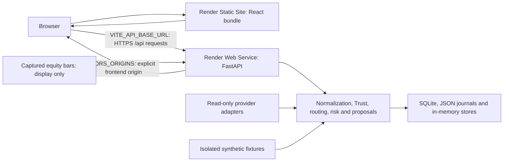

# Parity Pulse

**Clarity before exposure.** Parity Pulse analyzes tokenized equity representations against their underlying stocks using independent reference evidence, share-ratio normalization, market-session context, provenance and deterministic risk checks. It helps explain a price difference before proposing exposure, and abstains when the evidence is insufficient.

## Public demo

- **[Open the dashboard](https://parity-pulse-frontend.onrender.com)** — Render Static Site; scenario prices, fictional issuers and modeled holdings are labeled in the interface.
- **[Backend health](https://parity-pulse.onrender.com/api/health)** — Render Docker Web Service. Health checks database connectivity; it does not verify every workflow or market feed.
- **[Runtime status](https://parity-pulse.onrender.com/api/system-status)** — active data/execution settings and execution-gate status.

The public deployment is a shared, non-live demo. **No real funds move; live SWAP, RFQ and Agentic Wallet execution remain blocked.** Scroll past the interactive paper entrance to reach the dashboard.

## Capabilities

| Capability | Implementation and scope |
|---|---|
| Discovery and comparison | Stock resolution, tokenized representation discovery, issuer comparison and deterministic shares-per-token normalization; real-provider availability depends on credentials and entitlement. |
| Trust analysis | Freshness, timestamp alignment, session compatibility, liquidity, news context and historical coverage checks. Missing evidence produces limitations or `INSUFFICIENT_EVIDENCE`. Production admission remains blocked. |
| Opportunity, routing and risk | Shared deterministic services evaluate eligibility, exposure economics and risk constraints. The scenario dashboard demonstrates decisions; production Opportunity admission remains blocked by Trust. |
| Proposals and preparation | Structured dry-run proposals, quote/preparation contracts and readiness diagnostics. Demo quotes and local constraint simulation do not establish executable mainnet equivalence. |
| Portfolio and scorecard | Position lifecycle, modeled exposure, paper P&L, evaluation records and decision traces. Scenario balances and outcomes are not connected account balances or verified predictive performance. |
| Research | Labeled scenario assumptions and point-in-time historical replay where the required evidence exists. Optional bounded language-model interpretation is disabled in the public demo. |
| Charts and navigation | Overview, Markets, Trust & Signals, Opportunities, Portfolio, Research Lab and Scorecard, with a separate provider/operations workspace. Captured historical equity charts are kept separate from modeled token economics. |

The explicit DEMO Sandbox also supports NORMAL, LIKELY_NOISE and LIKELY_INFORMATION through the existing Trust → Opportunity → Risk → Routing → Quote → Preparation → local Simulation → Paper Position/Exit/Scorecard pipeline where scenario rules permit. Stand-down scenarios stop with their actual decision reasons. This sandbox requires `RUNTIME_MODE=DEMO`; it is separate from the default presentation dashboard.

## Architecture

The React/TypeScript frontend is built with Vite, TanStack Query, Tailwind/CSS and Lucide. The paper entrance uses Three.js/WebGL with a static fallback; transitions use GSAP. FastAPI, Pydantic and HTTPX provide typed APIs and provider adapters. Backend services own financial arithmetic, provenance and safety decisions; React renders their results.



The browser calls the backend directly in the public deployment. Locally, an unset API origin preserves same-origin `/api` requests through Vite or nginx. CORS controls browser access to responses; it is not authentication and does not relax execution policies.

Provider integrations include Binance Web3/RWA market data, Massive equity/news, explicitly selected Alpaca equity data, and optional Finnhub event/calendar context. Twelve Data, GeckoTerminal and Hyperliquid investigation scripts do not automatically admit those sources into production Trust. An optional MCP stdio bridge exposes allowlisted analytical/proposal tools. The Agent Studio sidecar is not an enabled or verified execution path and is unnecessary for the dashboard.

## Safety and execution model

`DATA_MODE=DEMO` selects fixture inputs, `EXECUTION_MODE=DRY_RUN` permits non-executable proposals, and `APPROVAL_MODE=PROPOSE_ONLY` prevents autonomous execution. `LIVE_TRADING_ENABLED=false` and `REQUIRE_SIMULATION=true` are mandatory. Startup rejects live execution, autonomous approval, enabled trading and disabled simulation.

`RUNTIME_MODE=LIVE` names the ordinary backend runtime and its storage/API wiring; it does **not** enable trading. `RUNTIME_MODE=DEMO` requires DEMO data and uses isolated in-memory lifecycle stores with sandbox routes. The default presentation dashboard uses synthetic analytical inputs in either runtime.

| Production gate | Status |
|---|---|
| DATA_GATE | PASS |
| DRY_RUN_GATE | PASS |
| TRUST_GATE | BLOCKED |
| OPPORTUNITY_GATE | BLOCKED_BY_TRUST |
| SWAP_LIVE_GATE | BLOCKED |
| RFQ_LIVE_GATE | BLOCKED |
| AGENTIC_WALLET_LIVE_GATE | BLOCKED |

Synthetic evidence never contributes to production historical coverage or unlocks these gates. Binance `referencePrice` is not an independent traditional-equity reference. Stale quotes, unknown historical ratios and local simulations cannot substitute for verified point-in-time evidence or exact execution-envelope equivalence.

## Local development

Requirements: **Python 3.12+** and **Node.js 22.12+**. From the repository root:

```sh
python3 -m venv .venv
source .venv/bin/activate
python -m pip install -r requirements-dev.txt
npm ci
```

Use [.env.example](.env.example) as the backend template. Copy it to `.env` only if that file does not already exist; preserve existing configuration. Credentials are unnecessary for the default scenario experience. Keep them out of Git and all frontend variables.

Start the backend in one terminal:

```sh
.venv/bin/python -m uvicorn app.main:create_app --factory \
  --app-dir backend --host 127.0.0.1 --port 8000 --no-access-log
```

From the repository root, start the frontend in another terminal:

```sh
npm run dev
```

Open [http://127.0.0.1:5173/](http://127.0.0.1:5173/). Vite proxies `/api` to `http://127.0.0.1:8000`. The paper scene supports dragging/hover lighting, reduced motion and a branded WebGL fallback.

The [provider/operations workspace](http://127.0.0.1:5173/?workspace=verified#overview) is a separate interface; its URL does not certify data quality. Real-provider reads require explicit `DATA_MODE=LIVE_READ_ONLY`, provider selection and applicable credentials/feed entitlement. Unavailable reads do not silently fall back to synthetic data.

To use the isolated sandbox, replace the backend command with:

```sh
RUNTIME_MODE=DEMO DATA_MODE=DEMO .venv/bin/python -m uvicorn \
  app.main:create_app --factory --app-dir backend \
  --host 127.0.0.1 --port 8000 --no-access-log
```

Then open the [DEMO Sandbox](http://127.0.0.1:5173/?workspace=verified#demo-sandbox). Keep the other execution settings at their safe defaults below.

## Docker and Compose

The root [Dockerfile](Dockerfile) uses Python 3.12, runs as non-root UID/GID `10001`, binds `0.0.0.0:8000` and checks `/api/health`. It copies `backend/`, `data/demo/`, `data/calendar/` and `data/display/`, and creates writable database/research directories. Offline `HistoricalSource` inputs in `data/historical/` are not consumed by the API or included in the image. No pre-existing SQLite database is required; schemas and fixtures initialize at startup.

[Compose](compose.yaml) serves the frontend through unprivileged nginx and proxies `/api` to the backend. Published ports bind to loopback; its named volume preserves stores under `/app/var`, including the ordinary-runtime SQLite database. Presentation caches and the session-only paper ledger are not persisted by that volume, nor is the separate research directory. Compose leaves `RUNTIME_MODE` at its ordinary `LIVE` default while using DEMO data and dry-run safeguards.

```sh
docker compose up --build
```

Open [http://127.0.0.1:8080/](http://127.0.0.1:8080/). Render reports a successful backend Docker deployment, and public health was verified. **A local Docker build/run and Compose smoke test have not been performed in this environment; Docker is unavailable.** The Compose service hostname `backend` is not the public static-site API origin.

## Render deployment

Use two separate resources connected to this repository's `main` branch:

| Setting | Backend | Frontend |
|---|---|---|
| Resource | Docker Web Service, Free plan | Static Site |
| Root directory | Repository root | `frontend` |
| Dockerfile | `./Dockerfile` | Not used |
| Build command | Dockerfile build | `npm ci && npm run build` |
| Publish directory | Not applicable | `dist` |
| Startup | Dockerfile default uvicorn command | Static hosting |
| Health check | `/api/health` | Not applicable |

The supplied Render backend configuration is:

```dotenv
APP_ENV=production
RUNTIME_MODE=LIVE
DATA_MODE=DEMO
EXECUTION_MODE=DRY_RUN
APPROVAL_MODE=PROPOSE_ONLY
LIVE_TRADING_ENABLED=false
REQUIRE_SIMULATION=true
LLM_ENABLED=false
PORT=8000
LOG_LEVEL=INFO
CORS_ORIGINS=["https://parity-pulse-frontend.onrender.com"]
```

**Configuration discrepancy:** the public `/api/system-status` response checked on October 11, 2026 reports `runtime_mode=DEMO`, and `/openapi.json` includes the DEMO Sandbox routes. This differs from the supplied `RUNTIME_MODE=LIVE` setting. Check the active service environment and deployment in Render before treating that supplied value as effective. Both modes retain the same execution restrictions; this documentation audit changed neither environment nor gates.

The Dockerfile supplies `DATABASE_URL=sqlite:////app/var/parity-pulse.db`. Explicit DEMO runtime uses in-memory SQLite regardless of that URL. Keep `PORT=8000`: the current startup command and health check use the literal port 8000 rather than interpolating `PORT`. Provider/wallet credentials and `EXECUTION_WORKER_TOKEN` are unnecessary for this public demo.

Set the frontend **build-time** variable:

```dotenv
VITE_API_BASE_URL=https://parity-pulse.onrender.com
```

Use an HTTPS origin with no `/api` suffix or other path. Changing it requires a new frontend build/deploy. The backend CORS JSON array must contain the frontend origin exactly, without a trailing slash. Configure the static-site SPA rewrite `/*` → `/index.html` if needed for navigation; it is not an API proxy. The rewrite's dashboard configuration has not been independently inspected.

For a new deployment: deploy the backend with reviewed non-live settings; verify health and effective status; build/deploy the frontend with its backend origin; verify browser data loading and CORS. Test state-changing demo journeys only on isolated disposable state, and verify cold-start recovery separately. No capability gate passes as part of deployment.

### Verification scope

Public checks on October 11, 2026 established:

- Frontend HTML and its JavaScript bundle: HTTP 200; the bundle contains the configured backend origin.
- `/api/health`: HTTP 200, `ok`, database `connected`.
- `/api/system-status`: HTTP 200; DEMO data, DRY_RUN, PROPOSE_ONLY, trading disabled, simulation required, all three live gates blocked.
- Allowed-origin POST preflight with `Content-Type` and `X-Correlation-ID`: HTTP 200. Unlisted-origin preflight: HTTP 400, no allow-origin header. No cross-origin credentials allowance.
- NVDA/AAPL display history: HTTP 200, historical Alpaca/SIP five-minute bars for October 5–9; explicitly ineligible as production references.
- DEMO scenario catalog: HTTP 200, synthetic and production-ineligible.
- Stateless `/api/intent/parse`: HTTP 200, a valid $50 Nvidia request, with the allowed-origin response header. This only parses intent; it does not save a proposal or submit an order.
- Chrome rendered the landing content, Overview data and historical chart, and navigation to Markets with labeled scenario comparisons. This verifies representative browser data loading, not every interaction or workflow.

Saved research, scans, proposal persistence and paper-execution writes were not exercised against shared public state. Cold-start/restart recovery and local containers remain unverified. `/api/status` is not implemented; use `/api/system-status`.

Local `main`, `origin/main` and GitHub `main` matched commit `52ad7f743d0fb0a329644db254c7472a3a53986f` during review. The public APIs expose service version `0.1.0`, not a Git commit identifier; the exact deployed commit remains unverified and must be checked in Render's deployment details.

## Configuration reference

Backend settings load the repository-root `.env`; environment variables override it. The frontend does not load that backend file. [frontend/.env.example](frontend/.env.example) documents its separate public build setting. Defaults below are from the implementation, not a claim about the deployed environment.

| Variable | Default | Supported values / requirement |
|---|---|---|
| `APP_ENV` | `development` | `development`, `test`, `production`; optional |
| `RUNTIME_MODE` | `LIVE` | `LIVE`, `DEMO`; DEMO requires DEMO data |
| `DATA_MODE` | `DEMO` | `DEMO`, `LIVE_READ_ONLY` |
| `EXECUTION_MODE` | `DRY_RUN` | Only DRY_RUN accepted by current startup policy |
| `APPROVAL_MODE` | `PROPOSE_ONLY` | Only PROPOSE_ONLY accepted |
| `LIVE_TRADING_ENABLED` | `false` | Must remain false |
| `REQUIRE_SIMULATION` | `true` | Must remain true |
| `LLM_ENABLED` | `false` | Explicit true/false; leave false for the demo |
| `DATABASE_URL` | SQLite file at repository `data/parity-pulse.db` | SQLite only, no URL credentials/options; Docker overrides the path; ordinary production runtime rejects in-memory SQLite |
| `LOG_LEVEL` | `INFO` | DEBUG, INFO, WARNING, ERROR, CRITICAL |
| `CORS_ORIGINS` | `[]` | JSON array of explicit origins; required for separate frontend/backend origins |
| `VITE_API_BASE_URL` | Unset | Frontend build-time HTTP(S) origin; production requires HTTPS; unset/empty preserves same-origin requests |
| `PORT` | Not a backend Settings field | Render configuration: 8000, matching the fixed Docker command |
| `POSTOPEN_EXIT_MINUTES` | `10` | Integer 1–120; lifecycle configuration |
| `EQUITY_PROVIDER` | `MASSIVE` | MASSIVE or ALPACA; explicit selection, no automatic fallback |
| `MASSIVE_DATA_QUALITY`, `ALPACA_DATA_QUALITY` | `UNKNOWN` | UNKNOWN, DELAYED, REALTIME; labels require verified entitlement/timestamp semantics |
| `ALPACA_FEED` | `iex` | iex, sip, delayed_sip, boats, overnight; entitlement-dependent |

Optional backend-only credentials: `BINANCE_WEB3_API_KEY`, `BINANCE_WEB3_SECRET_KEY`, `MASSIVE_API_KEY`, `ALPACA_API_KEY`, `ALPACA_SECRET_KEY`, `FINNHUB_API_KEY`, `LLM_API_KEY` and `EXECUTION_WORKER_TOKEN`. Each defaults to unset; never place them in a frontend build variable. The worker token does not unlock a live gate.

If LLM interpretation is explicitly enabled, `LLM_PROVIDER`, `LLM_MODEL` and credential-free HTTPS `LLM_BASE_URL` must be supplied. Limits default to `LLM_TIMEOUT_SECONDS=5` (1–30), `LLM_MAX_OUTPUT_BYTES=50000` (1024–50000), `LLM_MAX_OUTPUT_TOKENS=4096` (128–8192), and `LLM_STRUCTURED_OUTPUT=true`. Interpretation cannot authorize execution or replace missing evidence.

Origin validation rejects credentials, wildcard hosts, non-origin paths, queries and fragments. Production frontend origins require HTTPS; development also supports explicit HTTP loopback origins. CORS allows GET/POST/PUT and the transport's content-type/correlation headers, exposing `X-Request-ID`, `X-Correlation-ID` and `X-Run-ID` without cross-origin cookies. The API client retains canonical `/api/...` path validation, same-origin credentials policy, refused redirects, bounded timeouts, structured errors and no automatic proposal retries. Invalid configured origins fail closed.

## Data and persistence

| Data/state | Storage and meaning |
|---|---|
| Scenario prices, issuers, liquidity, holdings and outcomes | Isolated synthetic fixtures; modeled values, not live market observations or actual accounts |
| Display equity charts | Bundled historical Alpaca NVDA/AAPL capture under `data/display/`; historical, raw/unadjusted USD bars, excluded from Trust and execution inputs |
| Provider observations, proposals and assessments | SQLite; source, observation/publication time, ingestion time and quality remain distinct |
| Ordinary-runtime scans, agent records, execution/position/portfolio records, audit scorecards and tool receipts | Local stores/journals under the configured database directory; reset on Render Free filesystem loss |
| Explicit DEMO lifecycle and paper execution | In-memory stores; positions, exits, P&L and scorecards derived from that ledger reset with the process |
| Presentation workspace and saved scenario studies | Bounded in-memory cache shared across visitors; resets with the process |
| Terminal research artifacts | Separate local `data/research/phase5/` store; also ephemeral on Render Free |

No existing runtime database is needed to open the demo. Schemas initialize automatically and fixtures load from the image. Render Free can sleep after idle traffic and loses local filesystem changes on restart, redeploy or spin-down; persistent disks are unavailable on that plan. Do not rely on saved proposals, portfolio state or history surviving. [Render Free behavior](https://render.com/docs/free).

The public demo is not an authenticated, per-visitor isolated workspace. Avoid putting private account information into shared inputs. A cold start can exceed the client's bounded timeout; let the backend wake and use the existing Retry control. Successful cold-start recovery has not been verified here. Durable lifecycle operation requires a storage/deployment change; PostgreSQL is not a supported drop-in replacement in the current settings model.

Fixtures under [backend/tests/fixtures](backend/tests/fixtures) retain sanitized provider provenance and manifest hashes. Synthetic Finnhub protocol fixtures are not real event evidence. Local brand assets have [source provenance](frontend/public/brands/provenance.json); their presence does not establish endorsement or public/commercial redistribution rights.

## Tests and quality checks

From the repository root:

```sh
npm test
npm run build
.venv/bin/python -m pytest -q
.venv/bin/python -m ruff check backend scripts
PYTHONPATH=backend .venv/bin/python scripts/generate-ui-contracts.py --check
.venv/bin/python scripts/check-security.py
```

`npm run build` includes TypeScript checking. Backend and frontend tests cover deterministic analytical contracts, fixture isolation, fail-closed execution and transport behavior. Schema checks compare generated frontend contracts; security checks inspect configured-secret leakage and frontend isolation without printing credentials.

`npm run test:integration` requires the local backend on port 8000 and Vite on port 5173. It creates a dry-run proposal and Trust assessment in that local instance; use disposable DEMO state. It is not a public deployment check.

The local browser harness uses disposable credential-free backends and temporary screenshots, stopping only its own processes:

```sh
.venv/bin/python scripts/verify-frontend-phase15.py
```

Build first; this requires Google Chrome and free ports 8054–8057 and 5178. `--landing-only` restricts the journey to landing checks. Local fixture tests and browser journeys do not prove remote provider entitlement or live execution readiness.

## Known limitations and next work

- Production Trust requires admitted independent references, authoritative liquidity and qualifying as-of history, including the unchanged 30 baseline / 30 opening-model / 3 analogue safeguards in their applicable scopes. Historical ratios, coverage, entitlements and synchronization remain evidence blockers; event ingestion alone cannot resolve them.
- A successful display chart is not a fresh independent reference. No token history or historical share ratio is inferred from the equity capture. Provider feeds are not all live or complete, and their current entitlements were not retested during this documentation audit.
- Mainnet quote/build/simulation equivalence, wallet runtime authorization and live settlement readiness remain gated. Offline execution interfaces/tests do not establish a deployable trading service.
- Follow-up verification: reconcile the runtime-setting discrepancy and deployed commit in Render, test shared-state writes in an isolated environment, verify cold-start recovery, and run a local container smoke test when Docker is available. These checks must preserve all existing gates.

## Disclaimer

Parity Pulse is experimental financial demo software, not investment advice or an execution service. Scenario results and historical evaluations do not guarantee future performance.
